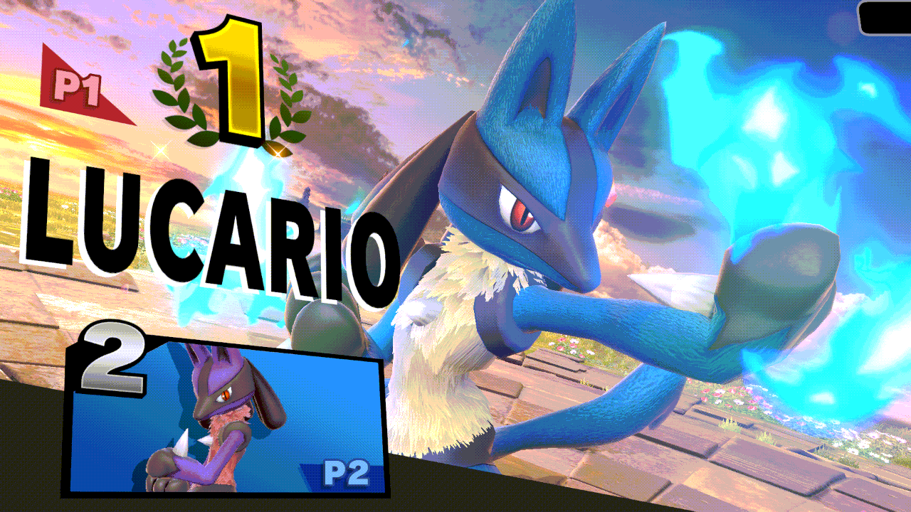
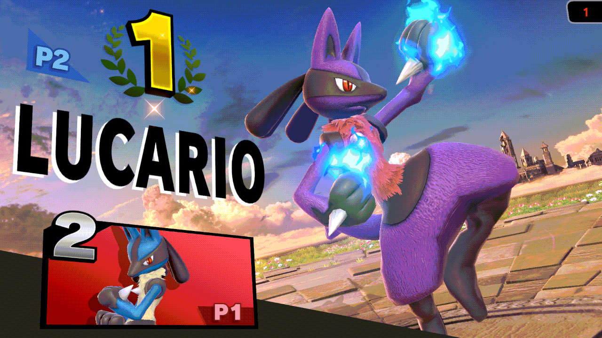

# elite-rematch

> **Disclaimer:** this project was developed with the assistance of AI
> (Claude, Codex and other coding agents) under the operator's direction and
> review. Nothing is claimed beyond the dated tests cited below.

Skyline plugin for Super Smash Bros. Ultimate 13.0.5 that keeps the online
rematch when you enter or leave Elite Smash. The game normally replaces
"Rematch?" with an Elite Smash notice that has no buttons, so the rematch is
gone even if both players want one. With the plugin you get both: the notice
and "Rematch?", with No and Yes.

| | Without the plugin | With elite-rematch |
|---|---|---|
| **Entering Elite Smash** |  |  |
| **Leaving Elite Smash** |  |  |

*Eden, 2026-10-31, the same route each time: a real Elite Smash change,
against a console without the plugin. Without it, the notice closes by
itself and the game goes back to the Quickplay menu. With 0.4.0, the notice
asks "Rematch?" too; both choose Yes and meet in the rematch room.*

## How it works

- The notice shows once per lobby; later rematches show the plain
  "Rematch?".
- Yes is the game's own rematch. No leaves, and the game then moves you into
  or out of Elite Smash as usual.
- The opponent does not need the plugin. UI only: no random draws, no match,
  rating or network changes. Tested in Eden in all four Elite / non-Elite
  combinations, rematches played to the end, no desync
  ([docs/SAFETY.md](docs/SAFETY.md)).
- Plays well with other plugins: it shares its hook spots through
  inline-hook sharing v1 (one hook, every plugin's callback), and chains
  onto hooks from plugins that do not share instead of replacing them.

## Install

Copy `libelite_rematch.nro` to
`sd:/atmosphere/contents/01006A800016E000/romfs/skyline/plugins/`. It
writes one install line to `sd:/ultimate/elite-rematch/events.log` (each
hook and how it went in); on any other game version it installs nothing.
Like the other plugins it keeps no thread and makes no heap allocation.

## More

- [docs/SAFETY.md](docs/SAFETY.md): what changes, what does not, Eden tests.
- [docs/EDEN-GAPS.md](docs/EDEN-GAPS.md): what Eden LAN Online needed for
  Elite Smash testing.

## Build

```text
cargo test
cargo skyline build --release
```

## License

MIT
