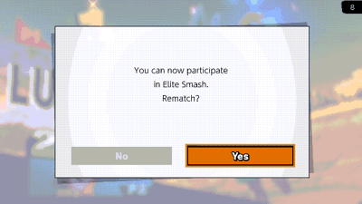
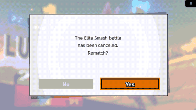

# elite-rematch

> **Disclaimer:** this project was developed with the assistance of AI
> (Claude, Codex and other coding agents) under the operator's direction and
> review. Nothing is claimed beyond the dated tests cited below.

Skyline plugin for Super Smash Bros. Ultimate 13.0.5 that keeps the online
rematch when you enter or leave Elite Smash. The game normally replaces
"Rematch?" with an Elite Smash notice that has no buttons, so the rematch is
gone even if both players want one. With the plugin you get both: the notice
and "Rematch?", with No and Yes.

| Entering Elite Smash | Leaving Elite Smash |
|---|---|
|  |  |

*Eden, 2026-10-30: real Elite Smash changes against a console without the
plugin; both choose Yes and meet in the rematch room.*

## How it works

- The notice shows once per lobby; later rematches show the plain
  "Rematch?".
- Yes is the game's own rematch. No leaves, and the game then moves you into
  or out of Elite Smash as usual.
- The opponent does not need the plugin. UI only: no random draws, no match,
  rating or network changes. Tested in Eden in all four Elite / non-Elite
  combinations, rematches played to the end, no desync
  ([docs/SAFETY.md](docs/SAFETY.md)).
- Plays well with other plugins: where another plugin already hooks the same
  spot, it chains onto that hook instead of replacing it, so both work.

## Install

Copy `libelite_rematch.nro` to
`sd:/atmosphere/contents/01006A800016E000/romfs/skyline/plugins/`. Popups
it changes are logged to `sd:/ultimate/elite-rematch/events.log`; on any
other game version it installs nothing.

## More

- [docs/SAFETY.md](docs/SAFETY.md): what changes, what does not, Eden tests.
- [docs/EDEN-GAPS.md](docs/EDEN-GAPS.md): what Eden LAN Online needed for
  Elite Smash testing.

## Build

```text
cargo test
cargo skyline build --release
```

## License

MIT
