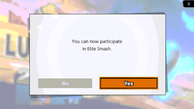

# elite-rematch

> **Disclaimer:** this project was developed with the assistance of AI
> (Claude, Codex and other coding agents) under the operator's direction and
> review. Nothing is claimed beyond the dated tests cited below.

Skyline plugin for Super Smash Bros. Ultimate 13.0.5 that keeps the online
rematch when a player enters or leaves Elite Smash. In the unmodified game
that match ends with a notice that has no buttons, so the rematch is gone
even if both players want one. With the plugin the popup shows the game's
Elite Smash notice and its "Rematch?" together, with No and Yes.



*Eden, 2026-10-30: one console (with the plugin) forced to the "entered
Elite Smash" notice, the other without the plugin; both choose Yes and meet
in the rematch room.*

## How it works

After an online match the game picks one of three popups: "Rematch?"
(No / Yes), or a notice without buttons when the fighter just entered ("You
can now participate in Elite Smash.") or left ("The Elite Smash battle has
been canceled.") Elite Smash. For the two notices the plugin loads the
"Rematch?" buttons into the popup with the game's own parser, and while that
popup is up it answers the notice's text with the notice plus the game's
"Rematch?" (both in the console's language). Yes is the game's normal
rematch; No leaves, and the game then moves you into or out of Elite Smash
as usual.

UI only: no random draws, no match, rating or network changes
([docs/SAFETY.md](docs/SAFETY.md)). The opponent does not need the plugin.
In Eden (2026-10-30) a console with the plugin really entered and left Elite
Smash against a console without it, Elite and non-Elite, in all four
combinations; each time both chose Yes, played the rematch to the end, and
the desync detector saw no mismatch on either console.

## Install

Copy `libelite_rematch.nro` to
`sd:/atmosphere/contents/01006A800016E000/romfs/skyline/plugins/`. The
plugin logs each popup to `sd:/ultimate/elite-rematch/events.log`; on any
other game version it installs nothing.

## More

- [docs/SAFETY.md](docs/SAFETY.md): what changes, what does not, Eden results.
- [docs/EDEN-GAPS.md](docs/EDEN-GAPS.md): what Eden LAN Online needs to test a
  real Elite Smash change.

## Build

```text
cargo test
cargo skyline build --release
```

## License

MIT
